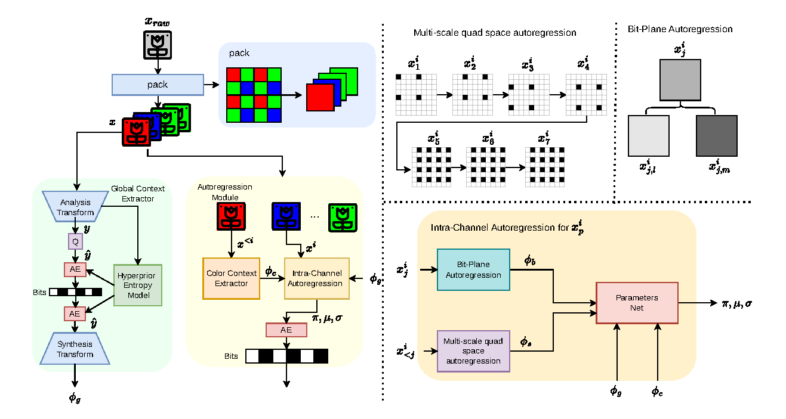
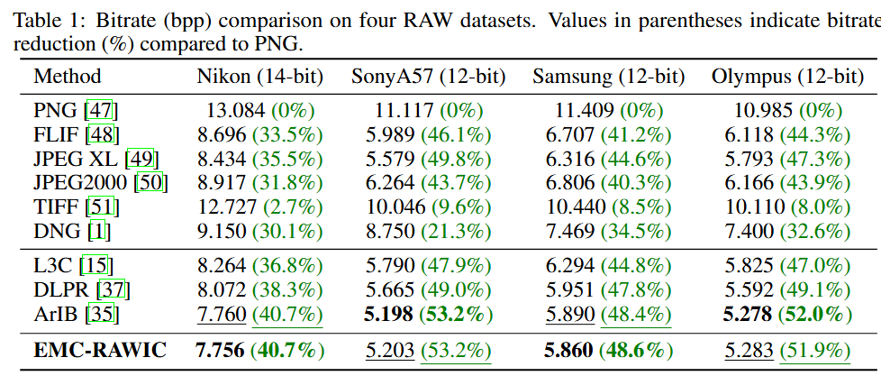
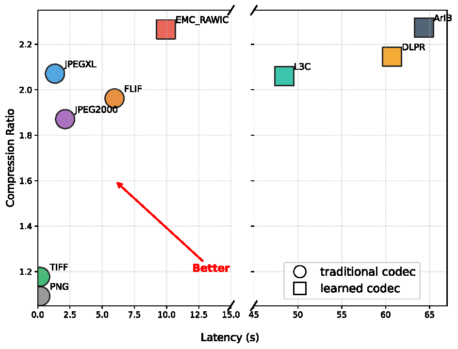

# Efficient RAW Image Compression (EMC_RAWIC)

This repository contains the official PyTorch implementation for **EMC_RAWIC**. 

Our framework is specifically designed for 4-channel RAW image lossless compression.

## 📌 Framework

<p align="center">
  <figure style="text-align: center;">
    
    <figcaption style="font-size: 14px; color: gray; margin-top: 5px;">
      <b>Figure 1:</b> The overall pipeline of our proposed EMC_RAWIC network.
    </figcaption>
  </figure>
</p>


## 🛠️ How to Start

### 1. Environment Preparation
Create a conda environment and install the necessary dependencies:
```
conda create -n emc_rawic -f environment.yml   
conda activate emc_rawic
```
#### ❗ Install `torchac` (Entropy Coding)
Our project relies on the `torchac` library for adaptive arithmetic coding. Please install it manually according to [L3C-PyTorch](https://github.com/fab-jul/L3C-PyTorch/) and place it in the local folder:
```bash
# Clone and build torchac into ./models/torchac
# Follow the installation guide from Mentzer et al. (CVPR 2019)
```

### 2. Dataset Preparation
for Sony, Samsung, Olympus, use generate_NUS to process dataset
NUS: https://yorkucvil.github.io/projects/public_html/illuminant/illuminant.html         
Nikon:  

Organize your RAW image dataset (e.g., Nikon, Sony, Samsung, Olympus) as follows:
```text
├── path_to_RAW
│   ├── train
│   │   ├── ...
│   └── test
│       ├── ...
```

### 3. Model Training & Finetuning

* **Train from scratch:**
  ```bash
  CUDA_VISIBLE_DEVICES=0 python train.py -d path_to_RAW --cuda -e 300 --save --save_path ./checkpoints --batch-size 6 --sony >> log_file.log
  ```
* **Finetune with a checkpoint:**
  ```bash
  CUDA_VISIBLE_DEVICES=0 python train.py -d path_to_RAW --cuda -e 100 --save --save_path ./checkpoints --batch-size 6 --sony --checkpoint ./checkpoints/best_model.pth -lr 1e-5 >> log_file.log
  ```

### 4. Model Evaluation (Testing)
Run the following script to test the model using pre-trained weights:
```bash
(1)fill paths in test.py
    main("path to testset","path to checkpoint")

(2) run: CUDA_VISIBLE_DEVICES=0 python test.py
```

---
## 📊 Experimental Results

We evaluate our model against standard codecs and deep learning baselines across different camera sensors.
<p align="center">
  <figure style="text-align: center;">
    
    <figcaption style="font-size: 14px; color: #555; margin-top: 8px;">
      <b>Figure 2:</b> bpp compared with standard codecs and baseline models.
    </figcaption>
  </figure>
</p>


<p align="center">
  <figure style="text-align: center;">
    
    <figcaption style="font-size: 14px; color: #555; margin-top: 8px;">
      <b>Figure 2:</b> bpp compared with standard codecs and baseline models.
    </figcaption>
  </figure>
</p>